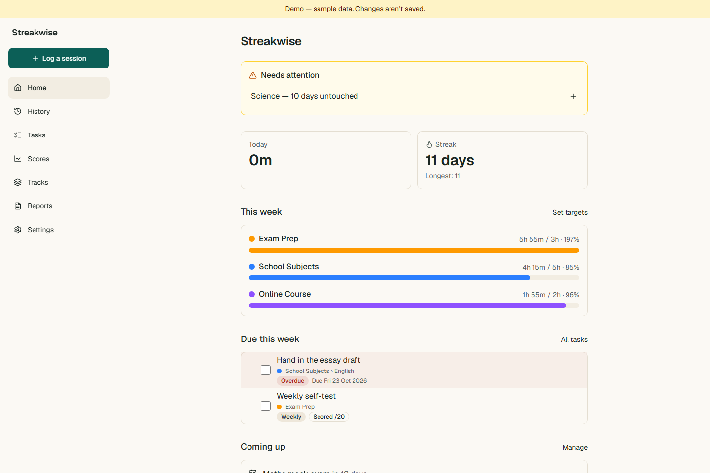
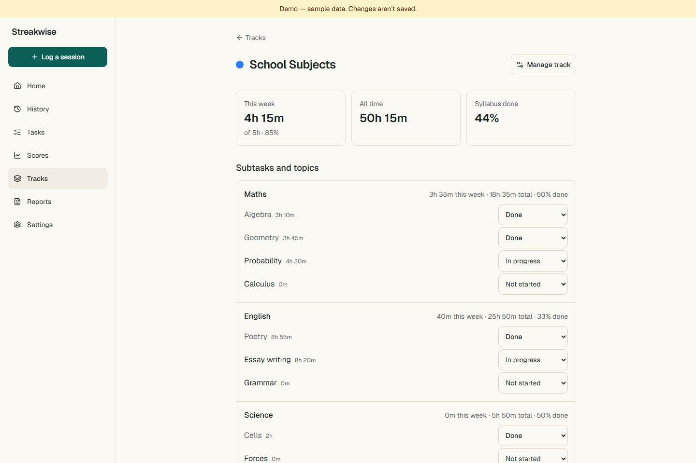
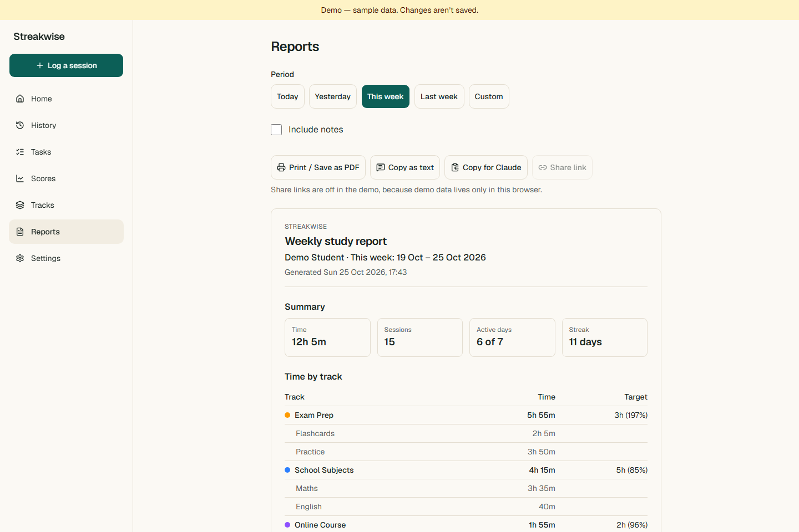
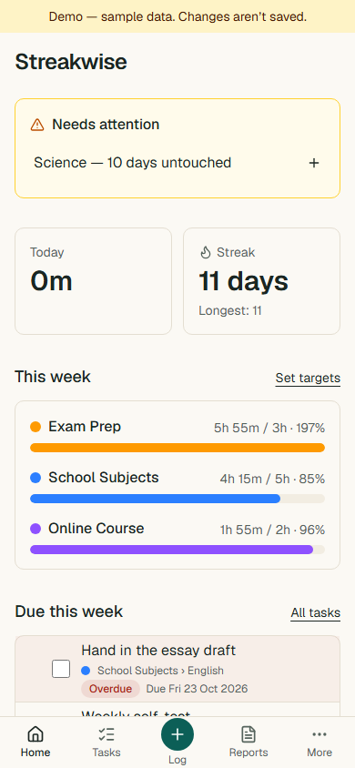
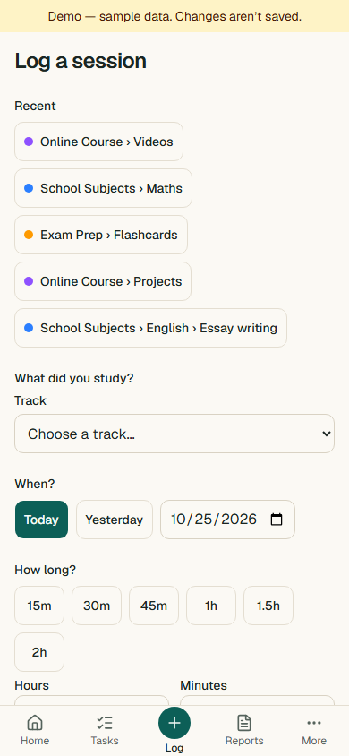
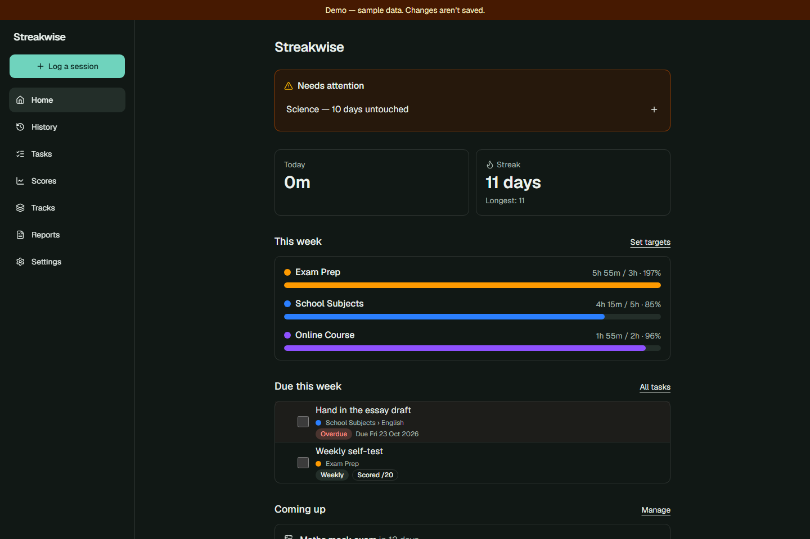
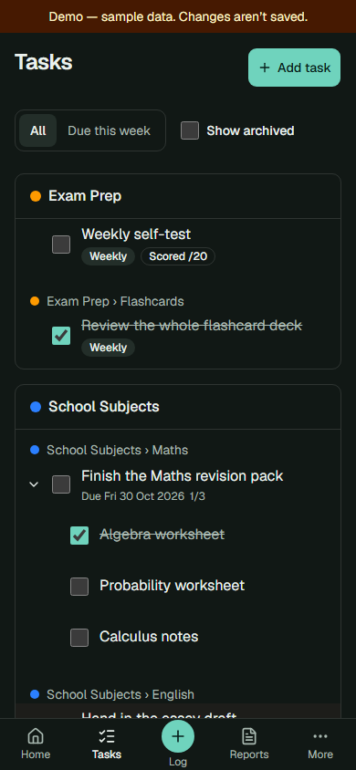

# Streakwise

A convenience tool for multitaskers. Juggle courses, projects, and goals side by side in one
place: log time in a few taps, see where your hours go, keep a streak alive, share clean reports,
and let Claude log sessions and analyse your progress for you.

[](https://github.com/Hammad-Sheikhh/streakwise/actions/workflows/ci.yml)
[](LICENSE)

**Live app:** [streakwise-mu.vercel.app](https://streakwise-mu.vercel.app) ·
**Try it without an account:** [the demo](https://streakwise-mu.vercel.app/demo) opens the full app
on sample data

## Screenshots

**Home** — today's time, the streak, weekly targets, and what needs attention.



**A track's page** — subtasks, syllabus %, topic status, scores, deadlines, and recent sessions.



**Reports** — any range, ready to print, send, or hand to Claude.



**On a phone**, where most logging happens:

| Home                                                      | Log a session                                               |
| --------------------------------------------------------- | ----------------------------------------------------------- |
|  |  |

**Dark theme** — the theme follows the system setting.

| Home                                                          | Tasks                                                         |
| ------------------------------------------------------------- | ------------------------------------------------------------- |
|  |  |

## Features

**Track your study**

- Organise goals as **tracks → subtasks → topics** (e.g. _Exam Prep → Practice_, or
  _School Subjects → Maths → Chapter 3_), each track with its own colour.
- Rename, recolour, add to, archive, or delete a track from its own page.
- Log a session in a few taps: pick what you studied, tap a duration, add an optional note.
- Mark topics _not started_, _in progress_, or _done_ and watch your syllabus percentage grow.

**See how you're doing**

- **Home dashboard:** today's time, current and longest streak, weekly targets with progress bars,
  tasks due this week, upcoming deadlines with days left, and a 12-month heatmap.
- **Neglect warnings** when a track or subtask hasn't been touched for a few days.
- **History** grouped by day, with filters and editing.

**Plan and measure**

- **Tasks** with sub-tasks nested as deep as you like, one-off or weekly, optionally scored.
- **Scores** for past papers, quizzes, mock tests, and self-tests, with trend lines per subject.
- **Deadlines** for exams and submissions, with the share of the syllabus still left.

**Share your progress**

- **Reports** for today, yesterday, this week, last week, or any range up to 92 days.
- **Print / Save as PDF**, **copy for WhatsApp**, or **copy for Claude** as Markdown.
- **Share links**: a frozen, read-only snapshot at an unguessable URL that expires after 7 days,
  30 days, or never, and can be revoked at any time. Private notes stay out unless you include them.
- **Export** everything as JSON, or sessions as CSV, with a reminder when a backup is due.

**Use it with Claude**

- Each account gets its own **Claude connector** (Model Context Protocol). Claude can read your
  structure, log sessions, check progress and gaps, manage tasks and scores, and build reports.

**Accounts**

- Sign up with email and password, confirm by email, reset a forgotten password, change it, or
  delete your account and all its data.

**Try it and install it**

- **Demo mode** opens the full app on 12 weeks of realistic sample data, right in your browser:
  nothing is sent anywhere, and a reload starts fresh.
- **Install it** to your phone's home screen or your desktop; it opens full-screen like an app, and
  still opens when you're offline.

## How it works

```
Browser (React)  ──►  DataSource  ──►  /api  (Vercel Functions, one dispatcher)  ──►  Supabase Postgres
                         │                       ▲
                         │                       │ same core services
                         └─► Demo mode ──►  core services + in-memory store (in the browser)

Claude  ──►  /mcp/<your link>  (MCP server function)  ──►  core services
```

- **One set of business rules.** All calculations (roll-ups, streaks, targets, neglect, reports)
  live in `src/core` as plain TypeScript. The API, the MCP server, and demo mode all call the same
  services, so the demo always behaves exactly like the real app.
- **The browser never talks to the database.** Every request goes through server functions that
  check the session and validate input with Zod. Row-level security is on with no public access.
- **Per-user data.** Every row belongs to one account, and composite foreign keys stop a row from
  pointing at another user's data.
- **Claude links.** A Claude link contains a long random token; only its hash is stored. Each link
  opens only its owner's data, and making a new link instantly retires the old one.
- **Time is honest.** Days are calendar days in one time zone, weeks run Monday to Sunday, and
  durations are whole minutes.

More detail: [Architecture](docs/architecture.md).

## Tech stack

React 19 · TypeScript (strict) · Vite · Tailwind CSS · shadcn/ui · TanStack Query · React Router ·
Zod · date-fns · Vercel Functions · Supabase (Postgres + Auth) · Model Context Protocol SDK ·
Vitest · React Testing Library · Playwright · GitHub Actions

## Quality

- **400 automated tests:** pure logic, services on an in-memory store, API handlers, the MCP server
  through the real SDK, database migrations on PGlite, and React screens.
- **End-to-end checks** in a real browser, on phone and desktop sizes: the demo journey (which must
  make zero network calls), the installable app, and WCAG A/AA on all eight screens in both themes.
- CI on every pull request: lint, Prettier, type-check, tests, a production build, and the
  end-to-end tests.
- Accessible by design: labelled inputs, keyboard navigation, visible focus, 44 px tap targets,
  and light/dark themes that follow the system, with colours checked for contrast.

## Running it locally

Requirements: Node 24, a Supabase project, and the Vercel CLI.

```bash
npm install
cp .env.example .env   # then fill in your own values (never commit .env)
npm run dev            # app + functions via vercel dev (run vercel link first)
```

| Command               | What it does                                                                       |
| --------------------- | ---------------------------------------------------------------------------------- |
| `npm run dev`         | App and functions locally                                                          |
| `npm test`            | Unit, service, component, API, MCP tests                                           |
| `npm run test:e2e`    | Playwright end-to-end tests on `/demo`                                             |
| `npm run screenshots` | Regenerate the screenshots in `docs/screenshots` (needs `npm run preview` running) |
| `npm run lint`        | ESLint                                                                             |
| `npm run typecheck`   | TypeScript                                                                         |
| `npm run build`       | Production build                                                                   |

Database changes live in numbered SQL files in [`supabase/migrations`](supabase/migrations).
Full setup steps: [Setup guide](docs/SETUP.md).

## Project structure

```
src/core/        business rules: types, Zod schemas, pure logic, services, in-memory store
src/data/        DataSource interface, API and demo implementations, query hooks
src/features/    screens: dashboard, log, history, tasks, scores, tracks, reports, settings, share
server/functions/   thin API handlers and the MCP server (one dispatcher per request: api/server.ts)
supabase/        migrations and their tests
e2e/             Playwright tests
docs/            specification, architecture, setup, progress
```

## Roadmap

- **Shipped:** every milestone in the [specification](docs/SPEC.md) — accounts, Claude connector,
  tasks and scores, reports and share links, demo mode and the installable app, and the polish pass.
- **Later ideas:** sign-in (OAuth) for the Claude connector, drag-and-drop in the structure editor,
  heatmap per track.

## Documentation

- [Product specification](docs/SPEC.md)
- [Architecture](docs/architecture.md)
- [Setup guide](docs/SETUP.md)
- [Build progress](docs/PROGRESS.md)

## License

[MIT](LICENSE) © 2026 Hammad Sheikh
