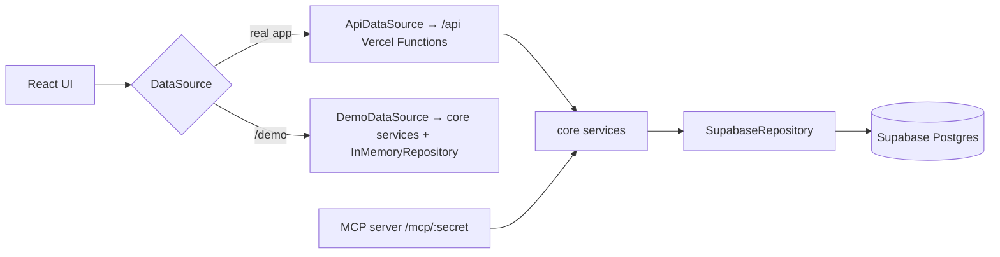

# Architecture

The design decisions behind the code, and where each piece lives. The full design is in
[SPEC §B12](SPEC.md#b12-architecture-and-code-organisation).

## Overview

- The browser never talks to Supabase directly.
- Business logic lives only in `src/core` and is shared by the API, the MCP server, and demo mode.
- Hosting (D20, 2026-10): Vercel runs exactly one function (`api/server.ts`); the route table in
  `server/functions/_lib/router.ts` maps each path and method to its handler, replacing Netlify's
  per-file `config.path` routing. `vercel.json` carries the rewrites (API prefixes + SPA fallback),
  the security headers, and the ignore command for docs-only commits.

## Folders

| Folder                | Purpose                                                                             |
| --------------------- | ----------------------------------------------------------------------------------- |
| `src/app`             | Routing, layout, providers, auth guard                                              |
| `src/features`        | One folder per screen area                                                          |
| `src/components`      | Shared UI (`components/ui` = shadcn/ui)                                             |
| `src/data`            | `DataSource` interface and implementations                                          |
| `src/core`            | Isomorphic domain types, Zod schemas, pure logic, services, repositories, demo data |
| `api`                 | The one deployed function (`server.ts`): dispatches everything it's rewritten to    |
| `server/functions`    | Thin per-route API handlers and the MCP server                                      |
| `server/tests`        | Tests for the functions (kept out of `api/` so they aren't deployed)                |
| `supabase/migrations` | Numbered SQL migrations                                                             |
| `e2e`                 | Playwright tests (demo journey, PWA, accessibility; run in CI)                      |

## Demo data

`src/core/demo/sampleData.ts` fills the demo's `InMemoryRepository` (DEMO-3): about 12 weeks of
sessions, topics in every status, nested, weekly, overdue, and "Other" tasks, past scores, 3
deadlines, and one neglected subtask (Science). Dates are relative to today and choices come from a
seeded generator (`random.ts`, mulberry32), so every visit and every test sees the same data. Today
is left empty so the visitor logs the day's first session. New accounts still start from the plain
seed (`services/seed.ts`); component tests use that seed too (`fakeApi`).

## Installable app (PWA)

- `public/manifest.webmanifest` and `public/icons/` (made from `favicon.svg` by
  `scripts/make-icons.mjs`) make the app installable (PWA-1).
- `build/service-worker.ts` writes `dist/sw.js` from `build/sw-template.js` on every production
  build, with that build's file list and a version hash, so each deploy gets a new worker and the old
  cache is deleted (PWA-2). It caches only the app shell: page loads try the network first and fall
  back to the cached `index.html`; hashed files come from the cache. It never handles `/api`, `/mcp`,
  `/auth`, or `/.well-known` requests, so data is never stored on the device.
- `src/lib/serviceWorker.ts` registers the worker in production builds only. `OfflineBanner` shows
  "You're offline" (PWA-3). `/sw.js` is served with `Cache-Control: no-cache`.

## Theme and accessibility (M8)

- **One set of design tokens.** Colours are CSS custom properties in `src/index.css`
  (Tailwind v4 `@theme inline`), so every shadcn/ui component picks them up. The palette is warm
  paper and sand neutrals, deep teal for actions, pale mint for highlights, and a warm brick red for
  destructive actions. Dark mode swaps the same token names inside
  `@media (prefers-color-scheme: dark)`, following the system setting (no manual switch, SPEC §B11);
  printing overrides them again for black text on white.
- **Charts keep their own colours.** The eight `--series-*` values are a separate categorical
  palette, checked with the dataviz validator against both backgrounds, and shared by track badges
  and score charts. Text never uses them for meaning on its own.
- **Contrast is tested, not eyeballed.** `e2e/a11y.spec.ts` runs axe-core over all eight screens in
  both themes, on the phone and desktop projects, and fails on any WCAG 2.1 A/AA violation. That
  caught tinted "overdue" rows: `--muted-foreground` and `--destructive` were darkened until they
  clear 4.5:1 on those backgrounds.
- **Keyboard and touch.** Radix supplies labelled dialogs, focus trapping, and Escape; focus rings
  use `--ring`; interactive controls are at least 44 px (`h-11`); status is never colour-only
  (topics have words, overdue tasks have a badge).
- **Screenshots stay honest.** `scripts/screenshots.mjs` (`npm run screenshots`) drives the demo in
  a real browser, in light and dark, at desktop and phone sizes, and writes `docs/screenshots/`.

## Performance

The shell is one bundle (about 225 KB gzipped, budget 250 KB) plus lazily loaded Reports and share
pages, so Home never waits for them. Charts are drawn with inline SVG rather than a charting
library, the dashboard is one `/api/dashboard` request, and the demo does all its work in memory.
Repeat visits are served from the service worker's app-shell cache (see above).

## Validation

Every service validates its own input with the Zod schemas in `src/core/schemas/inputs.ts`
(`parseInput`), so the API, MCP, and demo mode enforce the same rules. API handlers also validate
the request body first, which turns bad JSON into a 400 before any service runs. Repositories are
the last line of defence: the database (and `InMemoryRepository`, which mirrors it) rejects
duplicate sibling names, a fourth level, and deleting nodes that have history.

## Study day (v1.1, DAY)

Every "today" is the **study day**: `studyDate(now, dayEndsAtMinutes)` in
`src/core/logic/dates.ts` is the Karachi date of `now` minus the "My day ends at" setting
(`user_settings.day_ends_at_minutes`, 0–360). Services get it through `studyToday(repo, clock)`
(`src/core/services/today.ts`), which reads the setting once per call; services that already read
settings (dashboard, progress, reports) call `studyDate` directly. The MCP endpoint reads the
setting once per request, so tool defaults, `today` fields, and the instructions agree. In the
browser, `useStudyDay()` (`src/data/useToday.ts`) does the same from the settings query; forms
that default to today wait for it. Stored dates never change when the setting does; timestamps
that become days at read time (a topic's done time, a node's creation for neglect) use the
current setting.

## Change history and undo (v1.1, UNDO)

`RecordingRepository` (`src/core/repo/RecordingRepository.ts`) wraps the user's repository and
writes one `change_log` entry after every successful change to sessions, scores, tasks,
completions, mistakes, nodes, and deadlines: source (`app` or `claude`), entity, action, a
one-line summary, and JSON snapshots before and after. The server wraps every logged-in request's
repository (`forUser`, source `app`; the MCP endpoint passes `claude`), and demo mode wraps its
in-memory store, so all three paths record the same way (D28). Reordering and no-op edits aren't
recorded. If recording fails, the write stands and only the error's name is logged.

`undoChange` (`src/core/services/changes.ts`) applies the inverse on the store underneath
(`withoutRecording`), so undo is never recorded and can't be redone. Deleted items come back with
their ids and creation times; a deleted task tree comes back with its completions and score links
(`restore_user_task_tree`), and a removed completion with its score (`complete_user_task_on`), each
in one database call. It refuses with 409 `changed_since` while a later change to the same item
stands, and 409 `cannot_undo` when the item can't be put back.

In the app, `useUndoToast` (`src/features/changes/useUndo.ts`) shows the 10-second Undo after
logging, ticking, scoring, deleting, and reviewing a mistake: it looks up the newest recorded
change to that item and undoes it, so the Recent changes screen (`/changes`) shows it as undone.
History older than 30 days is removed after a recorded change, at most once a day per user per warm
function instance (`dailyPrune`, UNDO-7).

## Exam view and Today card (v1.1, EXAM, TODAY)

- An exam is a deadline with `isExam`; its score targets are `exam_targets` rows. `getExamView`
  (`src/core/services/exams.ts`) picks the next upcoming exam (or the one asked for) and uses the
  pure rules in `src/core/logic/exam.ts` (§B9.16): modules are the exam node's visible children,
  each score goes to the module whose subtree holds it (scores on the exam node itself go to
  "Overall"), mock rows are distinct `mock_test` titles by their first date, and a row's target is
  the one named like it or the latest one dated by its first date. The page is lazy-loaded and
  reuses the score chart with a stepped target line.
- The Today card is part of the dashboard response (TODAY-4): today's task (§B9.15), minutes per
  subtask today, and pace per track with "needed per day" (§B9.14), from
  `src/core/logic/todayCard.ts`. The dashboard also counts mistakes due (ERR-6).

## Timer, search, export, and restore (v1.1, TIMER, DATA)

- **Timer:** one timer per device in `localStorage` (`streakwise.timer.api` or `.demo`: node and
  start time), read through `useSyncExternalStore` (`src/features/timer/timerStore.ts`), so it
  survives reloads and never calls the server while it runs. Stopping turns the run into minutes
  and the study day of its start (`src/core/logic/timer.ts`) and opens `/log` with them filled in.
- **Search:** History's `noteContains` goes down to the store (`ilike` in Supabase; `*` is a
  PostgREST wildcard, so the exact match is re-checked in code) and pages like the other filters.
- **Export format 2** adds mistakes, exam targets, and "day ends at"; CSVs for sessions, scores,
  tasks, and mistakes are built in the browser from the same export, with the formula guard.
- **Restore** (`src/core/services/backup.ts`): the file (format 1 or 2, at most 4 MB) is parsed
  with Zod and checked against every database rule (levels, sibling names, links between rows,
  one completion per period) before anything changes, so a restore never fails halfway. Every row
  gets a new id with its links remapped, then `restore_user_backup` (one transaction) deletes the
  user's study rows and inserts the new ones; the account, Claude link, shared links, and
  export/MCP times stay, and the change history is cleared. The browser runs the same checks to
  show a summary first, and downloads a fresh backup before it sends the file.

## Dashboard

`getDashboard` reads the tree, settings, deadlines, and a light list of every session
(`node, date, minutes`) once, then computes everything with the pure functions in `src/core/logic`
(roll-ups, streaks, neglect, syllabus %, heatmap). Supabase returns at most 1000 rows per request,
so `SupabaseRepository.listSessionFacts` reads in pages. For one person's history this stays small;
if it ever grows too large, a Postgres view or RPC can pre-aggregate it.

## API endpoints

All require a session cookie except `auth/login`, `auth/signup`, `auth/forgot`,
`auth/resend`, `auth/logout`, `health`, and `keepalive`. Every data endpoint reads and writes only the
logged-in user's rows (`deps.repo` is a per-user repository; see Accounts below).

| Endpoint                     | Methods       | Purpose                                                          |
| ---------------------------- | ------------- | ---------------------------------------------------------------- |
| `/api/auth/signup`           | POST          | Create an account (Supabase Auth), limited per IP                |
| `/api/auth/login`            | POST          | Email + password login (lockout), first-login seed               |
| `/api/auth/forgot`           | POST          | Email a reset link (same answer for unknown emails)              |
| `/api/auth/resend`           | POST          | Send the confirmation email again                                |
| `/api/auth/password`         | POST          | Change password; logs out other devices                          |
| `/api/auth/account`          | DELETE        | Delete the account and all its data                              |
| `/api/auth/logout`           | POST          | Clear the session cookie                                         |
| `/api/auth/me`               | GET           | Who is logged in (email, name), reset-link state                 |
| `/auth/confirm`              | GET           | Where email links land; logs in, then redirects                  |
| `/api/nodes`                 | GET, POST     | The structure tree; add a node                                   |
| `/api/nodes/:id`             | PATCH, DELETE | Rename, recolor, archive/restore; delete                         |
| `/api/nodes/:id/move`        | POST          | Move up/down among siblings                                      |
| `/api/sessions`              | GET, POST     | A 30-day History page (filters); log a session                   |
| `/api/sessions/:id`          | PATCH, DELETE | Edit or delete a session                                         |
| `/api/recent-nodes`          | GET           | The 5 most recently used nodes                                   |
| `/api/dashboard`             | GET           | Everything Home shows, in one request (DASH-1)                   |
| `/api/deadlines`             | GET, POST     | List and add deadlines                                           |
| `/api/deadlines/:id`         | PATCH, DELETE | Edit or delete a deadline                                        |
| `/api/settings`              | GET, PATCH    | Student name, neglect threshold, "My day ends at"                |
| `/api/claude-connection`     | GET, POST     | Whether a link exists; POST makes a new one (shown once)         |
| `/api/reports`               | POST          | Build a report for a period (`buildReport`, REP-9)               |
| `/api/shares`                | GET, POST     | List share links; create one (server rebuilds the report)        |
| `/api/shares/:id`            | DELETE        | Revoke a share link (kept in the list, marked revoked)           |
| `/api/share/:slug`           | GET (public)  | A shared report's snapshot; 404 if unknown/expired/revoked       |
| `/api/restore`               | POST          | Replace all study data with a backup (checked first)             |
| `/api/export`                | POST          | All data as JSON (CSV is made in the browser); stamps time       |
| `/api/tasks/:id/complete`    | POST, DELETE  | Complete (optional `completedOn`); untick the period of `?date=` |
| `/api/changes`               | GET           | Changes from the last 7 days, newest first (UNDO-4)              |
| `/api/changes/:id/undo`      | POST          | Undo one change (UNDO-5)                                         |
| `/api/mistakes`              | GET, POST     | The Mistakes screen (due, all, per module); add one              |
| `/api/mistakes/:id`          | PATCH, DELETE | Edit (text, node) or delete a mistake                            |
| `/api/mistakes/:id/review`   | POST          | Review right or wrong (§B9.13)                                   |
| `/api/exam`                  | GET           | The exam view (`?deadline=`; default the next exam)              |
| `/api/deadlines/:id/targets` | POST          | Add a score target to an exam                                    |
| `/api/exam-targets/:id`      | PATCH, DELETE | Edit or delete a score target                                    |
| `/api/health`                | GET           | Liveness, no database                                            |
| `/api/keepalive`             | GET           | One trivial database read                                        |

## Accounts (M5A, SPEC D17)

- **Supabase Auth** holds accounts and passwords and sends the confirmation and reset emails
  (through Brevo SMTP). Only the server calls it (`_lib/authProvider.ts`, a fresh client per call
  with the secret key), so the browser still never talks to Supabase.
- **Sessions** are our own cookie `sw_session` = `<userId>.<issuedAt>.<expiry>.<HMAC>` (30 days,
  Strict). Supabase Auth checks the password only at login, so ordinary requests don't call it. A
  password change sets `user_settings.sessions_valid_after`; cookies issued earlier are refused
  (cached for up to 60 s per warm function instance).
- **Email links** use the token-hash flow: the templates in `docs/email-templates/` link to
  `<site>/auth/confirm?token_hash=…&type=signup|recovery`, which verifies the token on the server,
  logs the user in, and redirects (a reset link also sets the short-lived `sw_recovery` cookie).
- **Per-user data:** `user_id` on every table (migration `0003`, required since `0004`) with
  same-owner composite foreign keys, so the database itself refuses a row that points at another user's row.
  `SupabaseRepository` is built per user and filters every query by `user_id`; RPCs take
  `p_user_id`. Core services didn't change: they receive the user's repository.
- **Claiming old data (ACCT-7, done):** the owner moved the data from before accounts into their
  account with the old passcode after R3. Migration `0004` then made `user_id` required and removed
  the claim, the old `settings` table, and the old single-user RPCs; the code no longer has them.

## Claude connection (MCP)

`POST /mcp/<token>` (`server/functions/mcp.ts`) is a stateless Streamable HTTP server built
with the official SDK v2 (`@modelcontextprotocol/server`, `createMcpHandler`). It answers both the
2025 protocol and 2026-07-28 from one endpoint, building a fresh `McpServer` per request.

- **Auth:** each user's random token in the URL is the only credential (ACCT-8). Only its SHA-256
  hash is stored (`user_settings.mcp_token_hash`); the server looks the user up by hash and serves
  only that user's data. Anything else gets a plain 404. Only POST is accepted (a serverless
  function can't hold the GET event stream open).
- **Tools** are thin wrappers: resolve node and date references (`src/core/logic/nodeRef.ts`,
  `dateRef.ts`, against the study day), call a core service, return compact JSON text. The server
  is split by purpose under `server/functions/_lib/mcp/`: `server.ts` builds it,
  `instructions.ts` holds what Claude is told (with the current "My day ends at"), `views.ts` the
  output shapes, `tool.ts` the shared run/error helpers and annotations, and `tools/*.ts` the
  tools by area (structure, sessions, tasks, scores, mistakes). Input schemas live in
  `src/core/schemas/mcp.ts`. Domain errors come back as `isError` results with
  `{ error: { code, message, ...details } }` (for example `index` for a failed batch item, or
  `subtaskCount`), so Claude can correct itself.
- **v1.1 (MCP-10–24):** 30 tools. The 14 from v1.0 keep their names, parameters, and default
  output; new options (`compact`, filters, completion `date`) only add. Writes return the changed
  item; Claude's changes are recorded with source `claude` and can be undone in the app.
- Every tool call stamps the user's `last_mcp_call_at`, shown in Settings → Claude connection.
- Check it with MCP Inspector:
  `npx @modelcontextprotocol/inspector --cli <url> --transport http --method tools/list`.

## Environments

One Supabase project serves every environment (SPEC D15).

| Branch           | Vercel            | Database                |
| ---------------- | ----------------- | ----------------------- |
| Feature branches | Preview deploy    | Supabase (shared, real) |
| `develop`        | `develop` preview | Supabase (shared, real) |
| `main`           | Production        | Supabase (shared, real) |

## Decisions

See the decision log in [SPEC §B15](SPEC.md#b15-decision-log) and [PROGRESS.md](PROGRESS.md).
